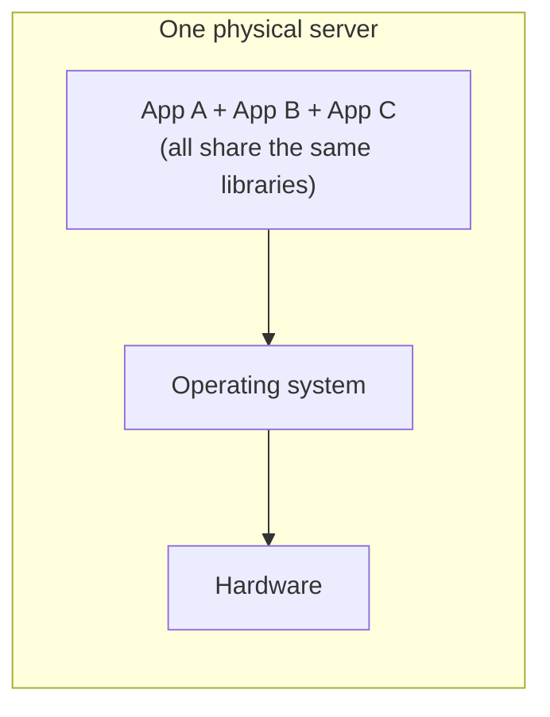
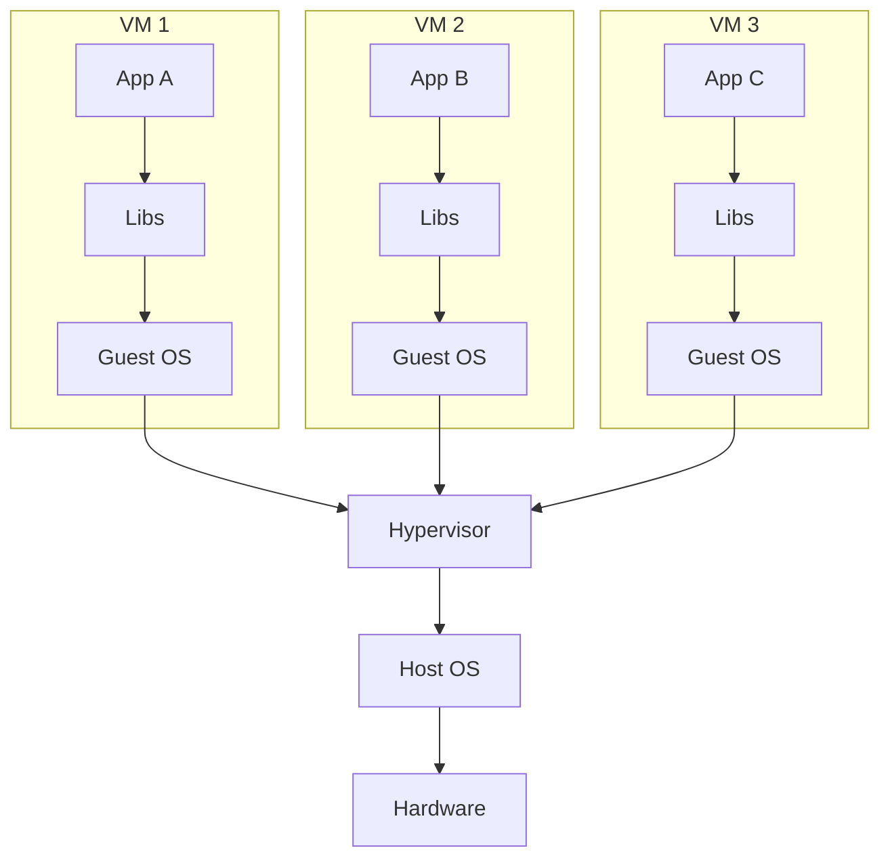
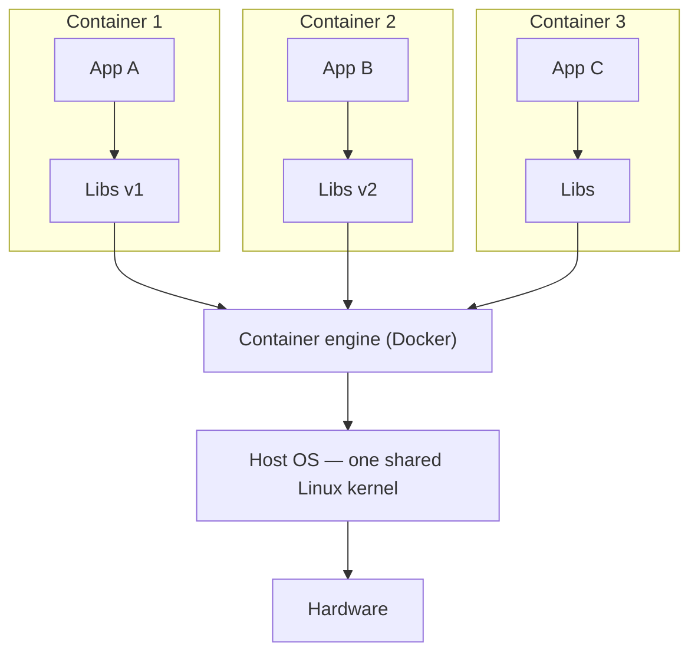
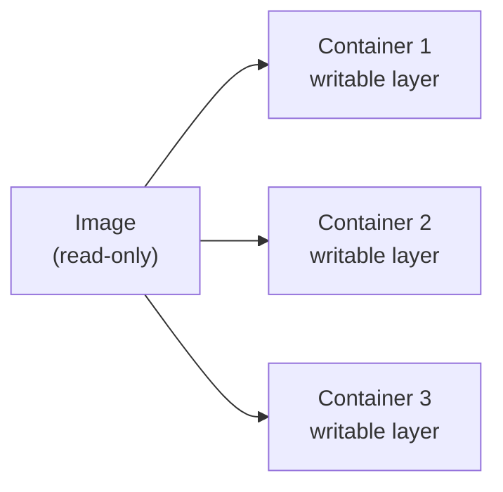
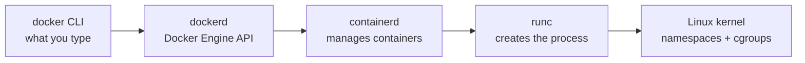

# Episode 1 — Why Containers Exist

> **Docker: Zero to GPU** · Episode 1 of the Docker series
> Concepts only. No commands are required to follow this episode, but there are optional Linux scripts at the end so you can see the ideas for yourself.

## What you'll learn

1. Why "it works on my machine" happens, and what actually breaks
2. How virtual machines solved the first problem, and what they cost
3. How containers are different from virtual machines
4. What a container really is inside Linux: a process with walls
5. The difference between an **image** and a **container**
6. Where Docker fits, and when VMs are still the better choice

---

## 1. The problem: "It works on my machine"

A developer builds and tests an app on a laptop. It's deployed to a production server, and it crashes.

| | Developer laptop | Production server |
|---|---|---|
| OS | Ubuntu 24.04 | RHEL 8 |
| Python | 3.12 | 3.8 |
| `requests` library | 2.32 | 2.20 |
| OpenSSL | 3 | 1.1 |
| Result | ✅ works | ❌ crashes |

**The code didn't change. The environment did.**

An application is not just its code. It's the code **plus** the environment around it: operating system, language runtime, libraries and configuration. Before containers, we shipped the code and left the environment behind.

> Containers let you ship the app and its environment together, as one package.

---

## 2. The old way: one app per physical server

Before VMs and containers, apps were installed directly on a physical server. That caused three problems:

| Problem | What happened |
|---|---|
| **Dependency conflicts** | App A needs library v1, App B needs v2. One OS usually means one installed version. |
| **Wasted capacity** | To avoid conflicts, teams ran one app per server. Most servers sat mostly idle. |
| **Slow provisioning** | A new environment meant buying, racking and installing hardware. Weeks, not seconds. |



---

## 3. Fix #1: Virtual machines

A **hypervisor** (VMware, VirtualBox, KVM, Hyper-V) pretends to be hardware. It splits one physical machine into several virtual machines, and **each VM runs its own complete operating system**.



**Wins**

- Strong isolation: every VM has its own kernel
- Different operating systems on one machine (Windows next to Linux)
- Many apps per server without dependency conflicts

**Costs**

- Every VM carries a whole OS, so images are gigabytes
- VMs boot like real computers, in minutes
- RAM and CPU are spent just keeping guest operating systems alive

The question became: does every app really need its own operating system, or does it just need to *believe* it has its own machine?

---

## 4. Fix #2: Containers

Containers remove the guest operating system. Each container contains only what its app needs (libraries, runtime, files), and **all containers share the host's Linux kernel**.



- App A can still have library v1 and App B library v2, because each container has its own private files.
- Starting a container is starting a **process**, not booting a computer, so it takes about as long as starting the app.
- Each app still believes it's alone: its own files, network and process list.

> **Kernel** = the core of the operating system. It talks to the hardware, schedules processes and manages memory. VMs each have their own; containers share the host's.

---

## 5. VMs vs containers at a glance

Typical values, not hard rules:

| | Virtual machine | Container |
|---|---|---|
| **Size** | Gigabytes (full OS) | Megabytes (app + libraries) |
| **Startup** | Minutes | Seconds or less |
| **Isolation** | Own kernel, very strong | Shared kernel, process-level |
| **Density** | Tens per host | Hundreds per host |
| **Portability** | Heavy image files | Same image runs anywhere Docker runs |

Containers did **not** replace VMs. In the cloud, your containers almost always run **inside** VMs. They solve different problems and work well together.

---

## 6. Under the hood: a container is a process with walls

A container is not a tiny virtual machine. It is an ordinary Linux process with three things built around it:

| Wall | Controls | What it does |
|---|---|---|
| **Namespaces** | What the process can **see** | Its own process list, network, hostname and filesystem view |
| **cgroups** (control groups) | What the process can **use** | Limits on CPU, memory and disk I/O, so one container can't starve the rest |
| **Image filesystem** | What the process **ships with** | A stack of read-only layers holding the app, libraries and config |

No hypervisor. No guest OS. These are features built into the Linux kernel; Docker made them easy to use.

### The six namespaces you'll meet

| Namespace | Gives the container | Where you'll see it |
|---|---|---|
| **PID** | Its own process tree. Your app thinks it's process 1. | Episode 2: `ps` inside a container shows 1–2 processes |
| **NET** | Its own IP address, ports and interfaces | Episode 2: why `-p 8080:80` is needed |
| **MNT** | Its own view of the filesystem | `/` inside a container is the image, not your host |
| **UTS** | Its own hostname | Episode 2: hostname = container ID |
| **IPC** | Its own shared memory and message queues | Containers can't read each other's memory |
| **USER** | Root inside can map to a normal user outside | Security episode |

---

## 7. Image vs container

| | Image | Container |
|---|---|---|
| What it is | A read-only blueprint | A running instance of an image |
| Analogy (code) | A class | An object |
| Analogy (kitchen) | A recipe | A dish cooked from it |
| Changes? | Never; built once, versioned, shared | Gets a thin writable layer on top |



**Beginner gotcha:** deleting a container deletes its writable layer. Any data written inside it is gone. That's by design, and it's why volumes exist (Episode 5).

---

## 8. Where Docker fits

When you type a `docker` command, it passes through several layers:



Containers are older than Docker:

| Year | Milestone |
|---|---|
| 1979 | `chroot`: change what a process sees as its root folder |
| 2000 | FreeBSD jails |
| 2008 | cgroups in the Linux kernel; LXC (Linux Containers) |
| 2013 | Docker: a simple image format, a simple CLI and Docker Hub |
| 2015 | OCI standard, so Docker images also run on Kubernetes and other runtimes |

Docker's real innovation was the developer experience, not the isolation.

---

## 9. When VMs still win

| Situation | Why a VM |
|---|---|
| You need a **different kernel** | Containers share the host kernel. Docker Desktop on Mac and Windows quietly runs a small Linux VM for exactly this reason. |
| You run **untrusted code** | A shared kernel is a shared attack surface. Multi-tenant platforms often use micro-VMs (Firecracker) or sandboxes (gVisor). |
| You need **kernel-level changes** | Loading kernel modules or changing kernel settings affects every container on the host. |

---

## 10. Try it yourself (optional, Linux only)

These scripts show the ideas from this episode **without Docker**, using plain Linux. They're read-only or temporary and change nothing permanent on your system.

| Script | Needs root? | What it shows |
|---|---|---|
| [`scripts/inspect-isolation.sh`](scripts/inspect-isolation.sh) | No | Your kernel, PID 1, the namespaces and cgroup of your current shell |
| [`scripts/mini-container.sh`](scripts/mini-container.sh) | Yes (`sudo`) | A "container" built by hand with `unshare`: its own PID tree and hostname |

```bash
cd docker/ep01-why-containers-exist
chmod +x scripts/*.sh

./scripts/inspect-isolation.sh
sudo ./scripts/mini-container.sh
```

On macOS or Windows, run them inside a Linux VM or WSL 2. On WSL 2, `inspect-isolation.sh` works; `mini-container.sh` needs a distro with `util-linux` installed (standard on Ubuntu).

What to look for in `mini-container.sh`:

- `ps` inside shows only a couple of processes, and the shell is **PID 1**: that's the PID namespace.
- The hostname inside is `mini-container`, but your real hostname is unchanged: that's the UTS namespace.

You just built the core of a container with one Linux command. Episode 14 goes much deeper.

---

## Key terms

| Term | Meaning |
|---|---|
| **Kernel** | The core of the OS that manages hardware, processes and memory |
| **Hypervisor** | Software that runs virtual machines by pretending to be hardware |
| **Container** | A process isolated with namespaces and cgroups, running from an image |
| **Image** | A read-only package of an app and its environment, made of layers |
| **Namespace** | A Linux feature that limits what a process can see |
| **cgroup** | A Linux feature that limits what a process can use |
| **OCI** | Open Container Initiative, the standard image and runtime format |

## Recap

1. An app = code + environment. Containers ship both together.
2. VMs virtualize hardware; containers isolate processes and share one kernel.
3. A container = a Linux process + namespaces + cgroups + image layers.

## Next episode

**[Episode 2 — Your first container](../ep02-your-first-container/)**: install Docker, run containers, read logs, step inside, and clean up.

## Slides

[`slides/Docker_Ep01_Why_Containers_Exist.pptx`](slides/Docker_Ep01_Why_Containers_Exist.pptx) (full script in the speaker notes)
