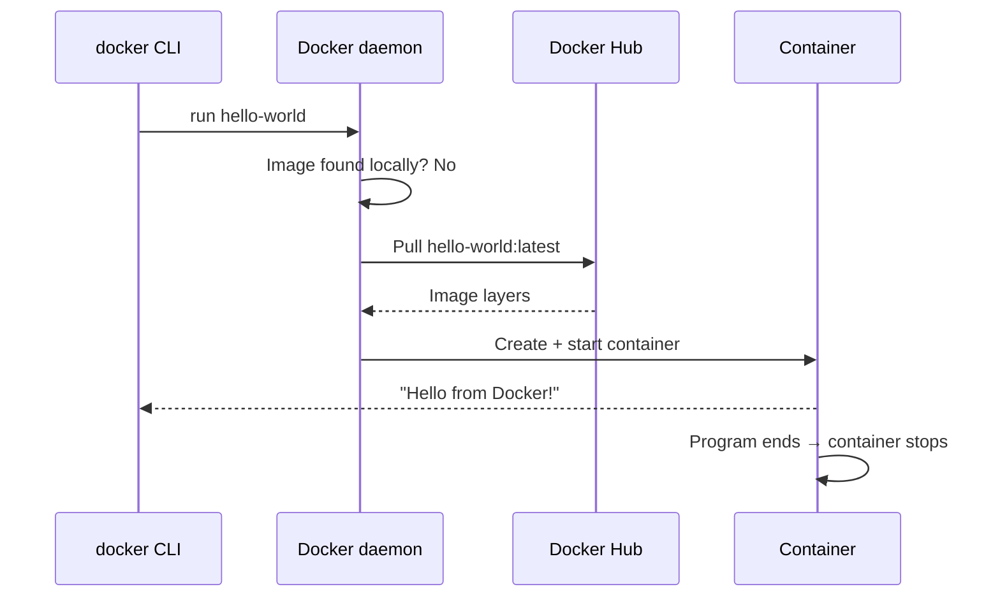
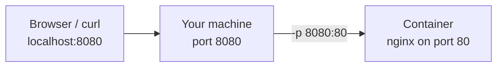
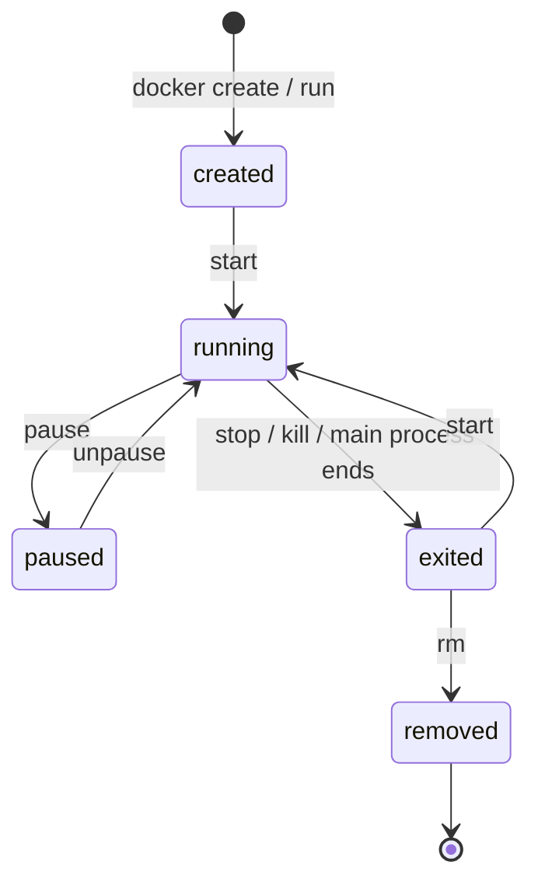

# Episode 2 — Your First Container

> **Docker: Zero to GPU** · Episode 2 of the Docker series
> Hands-on. Install Docker, run your first containers, look inside them, and clean up.
> Previous: [Episode 1 — Why containers exist](../ep01-why-containers-exist/)

## What you'll learn

By the end of this episode you can:

- **Install** Docker on Linux, macOS or Windows
- **Run** containers in the foreground and in the background
- **Inspect** running and stopped containers and read their logs
- **Enter** a running container with a shell
- **Clean up** containers and images and reclaim disk space

The one rule to remember from this episode:

> **A container lives exactly as long as its main process.**

---

## Quick start

```bash
git clone https://github.com/<your-username>/gpu-devops.git
cd gpu-devops/docker/ep02-your-first-container/scripts

./verify-docker.sh      # is Docker installed and working?
./run-all.sh            # every demo from the video, in order, pausing between steps
```

Or run the parts one at a time:

| Script | Video section | What it does |
|---|---|---|
| [`install-docker-linux.sh`](scripts/install-docker-linux.sh) | Install | Installs Docker Engine on Linux and optionally adds you to the `docker` group |
| [`verify-docker.sh`](scripts/verify-docker.sh) | Install | Checks the CLI, the daemon and permissions, then runs `hello-world` |
| [`01-hello-world.sh`](scripts/01-hello-world.sh) | Run | Pull, run and exit: your first container |
| [`02-run-nginx.sh`](scripts/02-run-nginx.sh) | Run | Runs nginx in the background on port 8080 |
| [`03-inspect.sh`](scripts/03-inspect.sh) | Inspect | `docker ps`, `ps -a`, stop/start and `docker logs` |
| [`04-exec.sh`](scripts/04-exec.sh) | Enter | Runs commands inside the container and changes the web page |
| [`05-interactive.sh`](scripts/05-interactive.sh) | Enter | `--rm`, PID 1, and why `docker run ubuntu` exits immediately |
| [`06-stop-kill-rm.sh`](scripts/06-stop-kill-rm.sh) | Clean up | stop vs kill vs rm, and proof that container changes vanish |
| [`07-cleanup.sh`](scripts/07-cleanup.sh) | Clean up | Removes the demo containers, shows disk usage, optional prune |
| [`08-common-errors.sh`](scripts/08-common-errors.sh) | Errors | Reproduces "port already allocated" and "name already in use" |

**Script options** (environment variables):

```bash
PORT=8081 ./02-run-nginx.sh            # use another host port if 8080 is busy
NAME=web2 ./02-run-nginx.sh            # use another container name
NGINX_IMAGE=nginx:1.27 ./run-all.sh    # pin an image tag (explained in Episode 3)
NO_PAUSE=1 ./run-all.sh                # run without pausing between steps
```

**Safe by design:** every container the scripts create carries the label `gpu-devops=ep02`. Cleanup removes only those containers, never your own. Anything that affects your whole Docker setup (`docker system prune`) asks first.

The scripts work on Linux, macOS (Docker Desktop) and Windows with WSL 2. On Windows, run them from the WSL terminal, not PowerShell.

---

## 1. Install Docker

### Linux: Docker Engine

The quickest way for learning is Docker's convenience script:

```bash
curl -fsSL https://get.docker.com -o get-docker.sh
sudo sh get-docker.sh
```

Or run [`scripts/install-docker-linux.sh`](scripts/install-docker-linux.sh), which does the same and handles the next step for you.

> For production servers, install from Docker's apt/yum repository instead so you control the version: <https://docs.docker.com/engine/install/>

**Run docker without `sudo`:**

```bash
sudo usermod -aG docker $USER
newgrp docker          # or log out and back in
```

> ⚠️ **Security note:** members of the `docker` group effectively have root access on that machine. Fine on your laptop; think twice on shared servers.

### macOS and Windows: Docker Desktop

Install Docker Desktop from <https://docs.docker.com/desktop/>. On Windows, use the **WSL 2** backend.

Docker Desktop runs a small Linux VM in the background, because containers need a Linux kernel (see Episode 1).

### Verify

```bash
docker version
docker info
```

`docker version` shows **two** sections:

| Section | What it is |
|---|---|
| **Client** | The `docker` CLI you type into |
| **Server** | The Docker Engine daemon (`dockerd`) running in the background |

If you only see **Client** plus a connection error, the daemon isn't running. Start Docker Desktop, or on Linux run `sudo systemctl start docker`.

---

## 2. Your first container: hello-world

```bash
docker run hello-world
```

What happens, step by step:



1. The CLI sends `run hello-world` to the daemon.
2. The image isn't on your machine (`Unable to find image 'hello-world:latest' locally`), so the daemon pulls it from Docker Hub. No tag given means `:latest`.
3. The daemon creates a container from the image and starts it.
4. The program prints its message and **exits**, so the container **stops**.

Run it a second time: no download, because the image is now cached locally.

---

## 3. Anatomy of `docker run`

```bash
docker run -d --name web -p 8080:80 nginx
```

| Part | Meaning |
|---|---|
| `docker run` | Create and start a new container |
| `-d` | **Detached**: run in the background and give your terminal back |
| `--name web` | A friendly name instead of a random one like `quirky_turing` |
| `-p 8080:80` | **Publish a port**: `HOST:CONTAINER`. Port 8080 on *your machine* forwards to port 80 *inside* the container |
| `nginx` | The image to run. Anything after it would be a command to run inside the container |



> **Remember:** in `-p`, the **left** number is your machine and the **right** number is inside the container. The mapping is needed because each container has its own network (the NET namespace from Episode 1).

---

## 4. Run a web server

```bash
docker run -d --name web -p 8080:80 nginx
curl localhost:8080          # or open http://localhost:8080 in a browser
```

Docker prints the full container ID and returns immediately. You now have a web server running, and nothing was installed on your machine.

---

## 5. See what's running: `docker ps`

```bash
docker ps        # running containers only
docker ps -a     # all containers, including stopped ones
```

| Column | Meaning |
|---|---|
| `CONTAINER ID` | Short form of the container's ID |
| `IMAGE` | The image it was created from |
| `COMMAND` | The main process |
| `CREATED` | When it was created |
| `STATUS` | `Up 2 minutes`, `Exited (0)`, … |
| `PORTS` | Port mappings, e.g. `0.0.0.0:8080->80/tcp` |
| `NAMES` | The container name |

**Stopped containers stick around.** They still exist, take a little disk space and keep their names until you remove them.

### The container lifecycle



```bash
docker stop web      # running → exited
docker ps -a         # still listed, STATUS: Exited
docker start web     # same container, same name, running again
```

---

## 6. Read logs: `docker logs`

```bash
docker logs web             # everything so far
docker logs -f web          # follow live (Ctrl+C stops following, not the container)
docker logs --tail 20 web   # last 20 lines
docker logs -t web          # add timestamps
```

`docker logs` shows whatever the container's main process writes to **stdout** and **stderr**.

> **Rule for your own apps:** log to stdout/stderr, not to a file inside the container. A log file is invisible to `docker logs` and disappears when the container is deleted.

---

## 7. Step inside: `docker exec`

```bash
docker exec -it web bash
```

| Flag | Meaning |
|---|---|
| `-i` | Keep input open (interactive) |
| `-t` | Allocate a terminal (TTY) |

Try these inside the container:

```bash
hostname                    # the container ID (UTS namespace)
cat /etc/os-release         # Debian, even on a Mac or Ubuntu host
echo "Hello from inside" > /usr/share/nginx/html/index.html
exit
```

```bash
curl localhost:8080         # → Hello from inside
```

- `exit` leaves **only** the shell you started with `exec`. The container keeps running, because its main process is nginx, not your shell.
- Your change lives in the container's **writable layer**. Section 9 shows what happens to it.

---

## 8. Interactive containers and the PID 1 rule

```bash
docker run -it --rm alpine sh
/ # ps
PID   USER     TIME  COMMAND
    1 root      0:00 sh
    7 root      0:00 ps
/ # exit
```

- `--rm` deletes the container automatically when it exits. Great for throwaway experiments.
- Inside, `sh` is **PID 1**. That's the PID namespace from Episode 1.

**Why does `docker run ubuntu` exit immediately?**

```bash
docker run ubuntu
docker ps -a        # ubuntu  "/bin/bash"  Exited (0)
```

The ubuntu image's main process is `bash`. Without `-it` there's no terminal for bash to read from, so it has nothing to do and exits. Main process ends, container stops. Exit code `0` means it finished normally; it didn't crash.

> When a container "dies instantly", ask: *what is its main process, and why did it end?* `docker logs` usually tells you.

---

## 9. Stop vs kill vs remove

| Command | What it does | When to use it |
|---|---|---|
| `docker stop web` | Sends **SIGTERM**, waits 10 s, then **SIGKILL** | Normal, graceful shutdown |
| `docker kill web` | Sends **SIGKILL** immediately | When `stop` hangs |
| `docker rm web` | Deletes a stopped container and its writable layer | When you're done with it |
| `docker rm -f web` | Stops and deletes in one step | Quick cleanup |

**Prove that container changes don't survive:**

```bash
docker rm -f web
docker run -d --name web -p 8080:80 nginx
curl localhost:8080       # back to "Welcome to nginx!"
```

The image is read-only, and every new container starts fresh from it. To keep data, use **volumes** (Episode 5).

---

## 10. Reclaim disk space

```bash
docker images                 # list local images and sizes
docker rmi hello-world        # remove an image
docker container prune        # remove ALL stopped containers
docker system df              # what is using disk?
docker system prune           # stopped containers, unused networks, dangling images, build cache
docker system prune -a        # ...and every image not used by a container
```

- `docker rmi` fails while any container, even a stopped one, still uses the image. Remove the containers first (`docker container prune`).
- ⚠️ Be careful with `prune -a`: every unused image has to be downloaded again. GPU images later in this series are several GB each.

---

## 11. Errors you'll hit (and the fix)

| Error | Cause | Fix |
|---|---|---|
| `Bind for 0.0.0.0:8080 failed: port is already allocated` | Something already uses that **host** port | Use another host port: `-p 8081:80`, or stop the other container |
| `Conflict. The container name "/web" is already in use` | Names are unique, even for **stopped** containers | `docker rm web`, then run again, or pick another name |
| `permission denied while trying to connect to the Docker daemon socket` | Your user isn't in the `docker` group | `sudo usermod -aG docker $USER`, then log out and back in |
| `Cannot connect to the Docker daemon` | The daemon isn't running | Start Docker Desktop, or `sudo systemctl start docker` |
| Container exits right away | Its main process ended | `docker ps -a` for the exit code, `docker logs <name>` for the reason |

Reproduce the first two safely with [`scripts/08-common-errors.sh`](scripts/08-common-errors.sh).

---

## Cheat sheet

```bash
# run
docker run -d --name web -p 8080:80 nginx
docker run -it --rm alpine sh

# inspect
docker ps
docker ps -a
docker logs -f --tail 20 web

# enter
docker exec -it web bash

# lifecycle
docker stop web
docker start web
docker kill web

# clean up
docker rm -f web
docker images
docker rmi <image>
docker system df
docker system prune
```

## Recap

1. **A container lives exactly as long as its main process.** That explains `hello-world` exiting, `ubuntu` exiting, and why `exit` from a `docker exec` shell doesn't stop the container.
2. **`-p HOST:CONTAINER`**: the left side is your machine.
3. **Changes inside a container die with the container.** The image stays clean.

## Homework

1. Run another image from Docker Hub, such as `redis` or `httpd`.
2. Publish its port, read its logs and `exec` into it.
3. Clean everything up with `docker container prune` and `docker system df`.

Stuck? Open an issue with your OS and the full error message.

## Next episode

**Episode 3 — Images and registries**: layers, tags vs digests, why `:latest` is a trap, and pushing your own image to Docker Hub.

## Slides

[`slides/Docker_Ep02_Your_First_Container.pptx`](slides/Docker_Ep02_Your_First_Container.pptx) (full script in the speaker notes)
